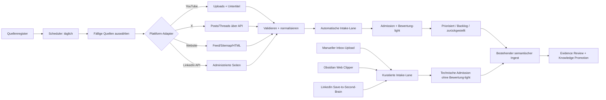

# Blueprint: automatisierte Clipping-Erfassung

**Ziel**: Kuratierte YouTube-Kanäle, X-Accounts und Websites regelmäßig erfassen, ohne manuell ausgewählte Quellen unnötig zu bewerten oder die Qualitätssicherung und den menschlichen Promotion-Checkpoint des Second Brain zu umgehen.

## Empfehlung in einem Satz

Eine lokale, zustandsbehaftete Collector-Pipeline mit getrennten Plattform-Adaptern soll automatisch entdeckte Inhalte in einer eigenen Intake-Lane ablegen und dort leicht bewerten. Manuell hinzugefügte oder per Web Clipper kuratierte Assets umgehen diese Bewertung und folgen weiterhin dem bisherigen semantischen Ingest mit menschlichem Review.

## Ausgangslage

Die Bestandsaufnahme vom 30. Juli 2026 umfasst 465 Dateien. Davon sind 219 YouTube-Clippings. 83 zusätzliche Dateien teilen bereits eine normalisierte Source-ID und 98 weitere Dateien sind byte-identische Extras. Bei 280 Dateien fehlen Autor- oder Kanalmetadaten. Das spricht für drei frühe Kontrollen: stabile Plattform-IDs, inhaltliche Hashes und ein verbindliches Metadatenschema.

Das bestehende `tools/new-clipping-intake.ps1` besitzt bereits gute Bausteine: Deduplizierung, Trust-Klassen sowie Relevanz-, Neuheits-, Evidenz- und Actionability-Scores. Es ist derzeit jedoch auf `raw/Clippings/`, einen Tages-Snapshot und feste ABM-/AI-Themen zugeschnitten. Für die Automation sollte es generalisiert und nicht parallel neu erfunden werden.

## Zielarchitektur



Der Scheduler läuft täglich, prüft aber nur Quellen, deren `next_check_at` erreicht ist. Eine Standardkadenz von 96 Stunden mit kleinem deterministischem Zeitversatz vermeidet starre Lastspitzen. Wird der Rechner ausgeschaltet, holt der nächste Lauf die versäumte Prüfung nach.

## Verbindliche Zwei-Lane-Regel

### Lane A: manuell ausgewählt oder kuratiert

Diese Lane umfasst:

- Dateien, die der Nutzer bewusst in einen Source-Inbox-Ordner legt
- Clippings aus dem Obsidian Web Clipper
- nutzerinitiierte LinkedIn- oder sonstige „Save to Second Brain“-Captures

Die bewusste Auswahl gilt bereits als Relevanzentscheidung. Diese Assets erhalten daher **keine Bewertung-light**. Sie durchlaufen nur technische Admission-Kontrollen wie Dateiintegrität, Metadatenprüfung, Source-ID und Deduplizierung und gehen danach in den bisherigen semantischen Ingest mit Evidence Matrix und menschlichem Promotion-Checkpoint.

### Lane B: automatisch entdeckt

Diese Lane umfasst ausschließlich Inhalte, die der Scheduler aus registrierten YouTube-Kanälen, X-Accounts, Websites oder genehmigten APIs selbst gefunden hat.

Nach der technischen Admission folgt die Bewertung-light. Sie entscheidet nur über die Reihenfolge:

- priorisierte Review-Liste
- normaler automatischer Backlog
- zurückgestellt

Kein automatisch entdecktes Asset wird aufgrund des Scores gelöscht. Erst priorisierte oder später ausdrücklich ausgewählte Assets wechseln in den bisherigen semantischen Ingest.

### Routing-Signal

Die Herkunft muss doppelt erkennbar bleiben:

- getrennter Pfad, zum Beispiel `inbox/raw/automated-clippings/`
- verbindliches Frontmatter-Feld `capture_mode: automated_discovery`

Manuelle Dateien erhalten `capture_mode: curated_manual`; bei bestehenden Web-Clipper-Dateien kann der Pfad `raw/Clippings/` als rückwärtskompatibles kuratiertes Signal dienen. Bei widersprüchlichen Signalen wird nicht bewertet, sondern zur manuellen Klärung angehalten.

## Kein universeller Scraper

### YouTube

**Discovery**: Die offizielle YouTube Data API liefert über den Channel-Datensatz die Upload-Playlist eines Kanals. Neue Videos können anschließend mit `playlistItems.list` günstig und inkrementell gelesen werden. Das ist effizienter und eindeutiger als wiederholte Suchabfragen. ([Channels](https://developers.google.com/youtube/v3/docs/channels), [PlaylistItems](https://developers.google.com/youtube/v3/docs/playlistItems/list), [Quota](https://developers.google.com/youtube/v3/determine_quota_cost))

**Transcript**: Die offizielle Captions API ist OAuth- und Caption-Management-orientiert; daraus folgt, dass sie kein verlässlicher öffentlicher Transcript-Endpunkt für beliebige fremde Kanäle ist. Für öffentliche Untertitel wäre `yt-dlp` mit `--write-subs` und `--write-auto-subs` der pragmatische Adapter. Er muss als potenziell fragiler, nicht offizieller Weg gekennzeichnet und separat freigegeben werden. ([Captions API](https://developers.google.com/youtube/v3/guides/implementation/captions), [yt-dlp](https://github.com/yt-dlp/yt-dlp/blob/master/README.md), [YouTube Terms guidance](https://support.google.com/youtube/answer/15509945))

Empfohlene Regel:

- Immer Video-ID, Kanal-ID, Titel, Veröffentlichungszeit, URL und Beschreibung erfassen.
- Vorhandene manuelle Untertitel vor automatisch erzeugten Untertiteln bevorzugen.
- Sprache und Transcript-Typ im Frontmatter dokumentieren.
- Zeitmarken bewahren.
- Wenn kein Transcript verfügbar ist, `transcript_status: unavailable` setzen; nicht stillschweigend Audio herunterladen oder Speech-to-Text starten.
- Audio-Download und lokale Transkription bleiben eine später separat zu genehmigende Rechte- und Kostenentscheidung.

### X

X-Inhalte sind primär Posts und Threads, keine Transcripts. Für beobachtete Accounts soll ausschließlich die offizielle User-Timeline-API verwendet werden. Sie unterstützt inkrementelle Abfragen, Zeitfilter und das Ausschließen von Replies oder Reposts. Antworten werden gecacht, Cursor und `since_id` werden gespeichert, und bei HTTP 429 greift Backoff. X trennt Rate Limits und nutzungsabhängige Abrechnung; beides gehört ins Betriebsmonitoring. ([Timelines](https://docs.x.com/x-api/posts/timelines/introduction), [Rate limits](https://docs.x.com/x-api/fundamentals/rate-limits))

Browser-Scraping sollte nicht als Fallback eingeplant werden: Die X-Nutzungsbedingungen untersagen Crawling oder Scraping außerhalb der veröffentlichten Schnittstellen ohne vorherige schriftliche Zustimmung. ([X Terms](https://x.com/en/tos))

Pro Post werden Text, Thread-Bezug, Autor-ID, Post-ID, Zeit, verlinkte URLs und verfügbare Medienmetadaten gespeichert. Video- oder Audio-Transkription ist nicht Bestandteil des ersten Piloten.

### LinkedIn

LinkedIn ist der klare Sonderfall. Die offizielle Posts API ist für Organisationen beziehungsweise Mitglieder mit passenden Rollen und genehmigten Berechtigungen vorgesehen. Der Community-Management-Zugang ist an Prüfung und Limits gebunden. LinkedIn untersagt außerdem Drittsoftware, Bots und Extensions, die Inhalte scrapen oder Aktivitäten automatisieren. ([Posts API](https://learn.microsoft.com/en-us/linkedin/marketing/community-management/shares/posts-api), [API access](https://learn.microsoft.com/en-us/linkedin/marketing/increasing-access), [Prohibited software](https://www.linkedin.com/help/linkedin/answer/a1341387/prohibited-software-and-extensions))

Darum:

- Automatische Abfrage nur für eigene oder administrierte Seiten mit genehmigtem API-Zugang.
- Für beliebige Creator vorerst ein nutzerinitiierter „Save to Second Brain“-Weg: Browser-Share, Web Clipper oder URL-Formular.
- Kein autonomes Browser-Login und kein DOM-Scraping als Produktionslösung.

### Websites

Für normale Websites gilt eine gestufte Discovery:

1. RSS/Atom, wenn vorhanden.
2. Sitemap mit `lastmod`.
3. Index- oder Listing-Seite.
4. Vollständiges Crawling nur als ausdrücklich konfigurierte Ausnahme.

Der Collector respektiert `robots.txt`, nutzt `ETag` und `If-Modified-Since` für unveränderte Seiten und speichert die kanonische URL. Dynamische JavaScript-Seiten werden erst dann über Firecrawl extrahiert, wenn Feed oder reguläres HTML nicht ausreichen. ([Robots Exclusion Protocol](https://www.ietf.org/rfc/rfc9309.html), [HTTP conditional requests](https://www.rfc-editor.org/rfc/rfc9110.html), [Sitemaps](https://www.sitemaps.org/protocol.html), [Firecrawl monitoring pattern](https://docs.firecrawl.dev/use-cases/observability))

## Quellenregister

Die versionierte Konfiguration sollte als `tools/config/clipping-sources.yaml` angelegt werden. Sie enthält keine Zugangsdaten.

```yaml
- source_id: yt-example-channel
  type: youtube_channel
  url: https://www.youtube.com/@example
  enabled: true
  cadence_hours: 96
  languages: [en, de]
  include_shorts: false
  backfill_days: 0
  tags: [ai, marketing]
  trust_class: practitioner
```

Pflichtfelder:

- stabile interne `source_id`
- Plattformtyp und kanonische URL beziehungsweise Plattform-ID
- aktiviert/pausiert
- Kadenz
- Sprach- und Inhaltsfilter
- Backfill-Regel
- Trust-Klasse und Start-Tags

Operativer Zustand wie Cursor, `last_checked_at`, `next_check_at`, Fehlerzahl und letzte Plattform-ID gehört in eine generierte State-Datei unter `wiki/_outputs/clipping-monitor/`. API-Schlüssel liegen ausschließlich in einer lokalen Secret-Verwaltung oder in Prozessvariablen.

## Leichte Bewertung automatisch entdeckter Assets

Die Bewertung ist ein **Routing-System**, kein Wahrheitsurteil. Sie gilt ausschließlich für `capture_mode: automated_discovery` und erfolgt erst nach der unveränderten Aufnahme der Quelle. Kuratierte Assets dürfen diesen Schritt nicht durchlaufen.

### Gemeinsames Gate: deterministische Aufnahmequalität

- stabile Source-ID vorhanden
- kanonische URL vorhanden
- Mindestmetadaten vollständig
- erwartete Sprache erkannt
- Transcript-Status und Transcript-Typ angegeben
- kein bereits bekannter Plattform-Identifier
- kein identischer Content-Hash
- Text nicht leer, abgeschnitten oder offensichtlich eine Fehlerseite

Fehlerhafte Quellen werden mit Grund quarantänisiert. Duplikate werden im Ledger registriert, aber nicht erneut als Quelle zugelassen. Dieses technische Gate gilt für beide Lanes und ist keine Relevanzbewertung.

### Nur Lane B: Relevanz-light

Die vorhandenen Dimensionen des Clipping-Intake werden beibehalten und aus einer editierbaren Relevanzkonfiguration gespeist:

| Dimension | Bereich | Bedeutung |
|---|---:|---|
| Themenfit | 0–3 | Passt zu aktiven Projekten oder Lernzielen |
| Neuheit | 0–2 | Ergänzt bestehendes Wissen statt es nur zu wiederholen |
| Evidenzdichte | 0–2 | Enthält Methode, Daten, Beispiele oder überprüfbare Aussagen |
| Handlungswert | 0–2 | Kann eine Entscheidung, Praxis oder ein Experiment informieren |
| Redundanzabzug | 0 bis −2 | Duplikatnah, wiederholend oder ohne zusätzliche Substanz |

Vorgeschlagenes Routing:

- 7–9: priorisierte Review-Liste
- 4–6: normaler Backlog
- 0–3: zurückgestellt, aber aufbewahrt
- ungeklärte technische Qualität: Quarantäne

Die Schwellenwerte sind Pilotannahmen. Sie müssen gegen echte Entscheidungen kalibriert werden. Um Qualitätsverlust durch falsche Negativentscheidungen sichtbar zu machen, wird zusätzlich eine zufällige 10-%-Stichprobe aus zurückgestellten Quellen geprüft.

## Technischer Zuschnitt

Für einen kleinen, wartbaren lokalen Dienst bietet sich ein einzelner Python-Prozess an:

- Adapter-Module für YouTube, X und Websites
- SQLite für Cursor, Plattform-IDs, Hashes, Laufstatus und atomare Wiederholbarkeit
- YAML nur für das versionierte Quellenregister
- ein PowerShell-Wrapper für die bestehende Windows-Task- und Source-Inbox-Integration
- später FastAPI plus schlichtes HTML für die lokale Verwaltung, ohne großes Frontend-Framework

Der Collector schreibt zuerst eine temporäre Datei, setzt `capture_mode: automated_discovery`, validiert Schema und Hash und verschiebt sie erst danach atomar nach `inbox/raw/automated-clippings/`. Der bestehende Source-Inbox-Importer bleibt die einzige Admission-Grenze zum geschützten Quellenbestand. Laufzusammenfassungen werden unter `wiki/_outputs/clipping-monitor/` ausgegeben; das operative SQLite-File und Secrets bleiben lokal und werden nicht versioniert.

## Lokale HTML-Verwaltung

Die Oberfläche kommt **nach** einem funktionierenden Collector-Piloten. Sie läuft nur auf `127.0.0.1` und schreibt nicht direkt aus dem Browser in den Vault. Ein kleiner lokaler Backend-Endpunkt validiert Änderungen und führt ein Audit-Log.

Minimaler Funktionsumfang:

- URL einfügen und „Quelle testen“
- automatisch erkannte Plattform, kanonische ID und Anzeigename prüfen
- Kadenz, Sprachen, Tags, Backfill und Filter festlegen
- Quelle aktivieren, pausieren oder einmalig starten
- letzter Lauf, nächster Lauf, neue Elemente und Fehler sehen
- Zugangsdatenstatus sehen, aber keine Secrets anzeigen

Eine extern gehostete HTML-Seite ist für den ersten Stand ungeeignet: Sie müsste lokalen Vault-Zugriff und Plattform-Credentials sicher überbrücken.

## Pilot und Abnahmekriterien

### Erste nützliche Ausbaustufe

- drei YouTube-Kanäle
- drei Websites
- zwei X-Accounts, sofern API-Zugang und Kosten akzeptiert sind
- LinkedIn nur nutzerinitiiert
- kein automatischer historischer Backfill
- zwei Wochen Laufzeit

### Vorläufige Abnahmekriterien

- alle nach dem gespeicherten Cursor erschienenen Testinhalte werden entdeckt
- mindestens 95 % der aufgenommenen Quellen haben Source-ID, URL, Titel, Veröffentlichungs- und Erfassungsdatum
- kein automatisierter Schreibvorgang verändert `raw/Clippings/` oder andere geschützte Quellen
- wiederholte Läufe erzeugen keine zweite zugelassene Quelle für dieselbe Plattform-ID
- Transcript-Sprache und `manual`/`auto`/`unavailable` sind korrekt ausgewiesen
- kein manuell hinzugefügtes oder per Web Clipper kuratiertes Asset erhält einen Relevanz-light-Score
- jedes automatisch entdeckte Asset trägt ein eindeutiges `capture_mode`- und Source-ID-Signal
- mindestens 70 % der priorisierten Stichprobe bewertet der Nutzer als review-würdig
- in der 10-%-Kontrollstichprobe der zurückgestellten Quellen bleiben weniger als 10 % klar relevante Quellen unentdeckt
- alle Quarantänefälle und Adapterfehler sind in der Oberfläche oder im Laufbericht sichtbar

Die letzten beiden Werte sind bewusst als Kalibrierungsziele formuliert und noch keine belegte Leistungszusage.

## Umsetzungsreihenfolge

1. Zwei-Lane-Routing, Quellenregister, State-Ledger und ein gemeinsames Markdown-/Frontmatter-Schema definieren.
2. Website- und YouTube-Discovery implementieren; Transcript-Adapter separat freigeben.
3. Automatische Ausgabe ausschließlich nach `inbox/raw/automated-clippings/`; vorhandenen Source-Inbox-Importer für die Admission verwenden.
4. Routingtests ergänzen: manuell und Web Clipper umgehen die Bewertung-light; nur `automated_discovery` wird bewertet.
5. Bestehendes `new-clipping-intake.ps1` auf den automatischen Pfad und eine konfigurierbare Relevanzmatrix erweitern.
6. Zweiwöchigen Pilot durchführen und Fehlerraten, Duplikate, Kosten sowie Bewertungsqualität messen.
7. X über die offizielle API ergänzen.
8. Erst nach bestandenen Gates die lokale HTML-Verwaltung bauen.
9. LinkedIn nur bei genehmigtem API-Zugang automatisieren; sonst beim nutzerinitiierten Capture bleiben.

## Approval State

Das Zwei-Lane-Modell ist als Routingentscheidung bestätigt: Bewertung-light gilt nur für automatisch entdeckte Assets; manuell hinzugefügte und per Web Clipper kuratierte Assets behalten den bisherigen Ingest. Der übrige Blueprint bleibt ein interner Vorschlag. Er autorisiert noch keine Installation eines Scheduled Tasks, keine API-Kosten, keine Zugangsdatenänderung, keinen `yt-dlp`-Transcript-Abruf und keine semantische Promotion. Die nächste sinnvolle Freigabe ist ein enger Pilot für Websites und YouTube-Discovery mit drei Quellen je Adapter.
