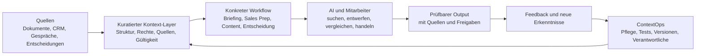

# Business Opportunities für AI-fähige „Second Brains“ in Deutschland und der EU

**Kurzfassung**: Der attraktivste Markt ist nicht der Verkauf eines „Second Brain“ als allgemeiner Wissensspeicher. Die bessere Geschäftschance ist ein produktisierter Service, der für einen klar begrenzten Geschäftsprozess verlässlichen Unternehmenskontext erzeugt, ihn mit einem AI-Workflow verbindet und seine Aktualität im Betrieb sicherstellt. Für den Markteintritt erscheinen **Agency Client Context Systems** als schnellster Lernmarkt und **Marketing-Sales Context Systems** als stärkster anschließender Wachstumsmarkt.

> **Zentrale Empfehlung:** Verkauft kein Tool und keine „besseren Prompts“. Verkauft die Fähigkeit eines Teams, in einem wichtigen Workflow schneller zu belastbaren, marken- und kundengerechten Ergebnissen zu kommen – ohne dass Geschäftsführung oder Senior-Experten jedes Mal den fehlenden Kontext nachliefern müssen.

---

## 1. Die strategische These

Generative AI wird immer leistungsfähiger, aber ein Modell kennt nicht automatisch:

- welche Kunden für ein Unternehmen attraktiv sind,
- welche Begriffe intern wie definiert werden,
- welche Aussagen freigegeben oder verboten sind,
- welche Annahmen einer Entscheidung zugrunde lagen,
- welche Quellen vertrauenswürdig und aktuell sind,
- welche Ausnahmen in einem bestimmten Prozess gelten,
- und wer eine Änderung freigeben darf.

Diese Lücke wird häufig als Prompting-Problem behandelt. In vielen Unternehmen ist sie in Wahrheit ein **Kontextproblem**. Ein guter Prompt kann fehlendes oder widersprüchliches Unternehmenswissen nicht ersetzen.

Das kommerzielle Produkt ist deshalb nicht der Wissensspeicher allein. Es ist ein arbeitendes System:

Ein professionelles „Second Brain“ ist damit:

1. eine **aktuelle, quellenbasierte Wissensbasis**,
2. eine **Kontextarchitektur** für einen bestimmten Arbeitsablauf,
3. eine **Retrieval- und Qualitätslogik**, mit der Mensch und AI das richtige Wissen finden,
4. eine **Governance-Schicht** für Rechte, Freigaben und Änderungen,
5. und ein **Pflegeprozess**, der verhindert, dass die Basis veraltet.

Viable Edge beschreibt einen ähnlichen Aufbau als professionelle, quellenbasierte Knowledge Base mit Audit, Architektur, Retrieval-Tests, Übergabe und Wartung. Das ist ein nützliches Servicemodell, aber die öffentlich genannte Größenordnung von etwa 1.500 bis 4.000 US-Dollar ist eine Anbieterangabe und kein Beleg für Zahlungsbereitschaft im deutschen Markt. Entscheidend ist, das Angebot an einen höherwertigen Geschäftsprozess zu koppeln. ([Viable Edge: Professional Knowledge Bases](https://www.viableedge.com/course/professional-knowledge-bases), [Knowledge Base vs. Second Brain](https://www.viableedge.com/blog/knowledge-base-vs-second-brain))

---

## 2. Warum jetzt ein Markt entsteht

### 2.1 AI-Nutzung wächst schneller als die organisatorische Reife

Im Jahr 2025 nutzten laut Eurostat 20 Prozent der EU-Unternehmen mit mindestens zehn Beschäftigten AI; 2024 waren es 13,5 Prozent. Bei kleinen und mittleren Unternehmen lag der Anteil bei rund 19 Prozent, bei großen Unternehmen bei 55 Prozent. In Deutschland meldete Destatis für 2025 eine AI-Nutzung von 26 Prozent und die Nutzung kostenpflichtiger Cloud-Dienste durch 54 Prozent der Unternehmen. ([Eurostat: AI use in enterprises 2025](https://ec.europa.eu/eurostat/web/products-eurostat-news/w/ddn-20251211-2), [Eurostat: Digitalisation in Europe 2026](https://ec.europa.eu/eurostat/web/interactive-publications/digitalisation-2026), [Destatis: IKT in Unternehmen](https://www.destatis.de/DE/Themen/Branchen-Unternehmen/Unternehmen/IKT-in-Unternehmen-IKT-Branche/_inhalt.html))

KfW berichtet 2026, dass rund 20 Prozent des deutschen Mittelstands AI einsetzen. Zugleich zeigt KfW einen deutlichen Zusammenhang zwischen digitaler Reife, strategischer Ausrichtung und AI-Nutzung. Das spricht dafür, dass nicht nur Modellzugang, sondern auch Daten-, Wissens- und Prozessreife den Wert bestimmt. ([KfW: Digitalisierung im Mittelstand](https://www.kfw.de/%C3%9Cber-die-KfW/KfW-Research/Digitalisierung.html))

Diese Zahlen belegen noch keine Nachfrage nach „Second-Brain-Beratung“. Sie belegen aber eine wachsende installierte Basis von Unternehmen, die bereits AI verwenden und damit erstmals praktisch erleben, dass generische Modelle ohne eigenen Kontext begrenzt sind.

### 2.2 Die Plattformanbieter verkaufen inzwischen selbst den Kontext-Layer

Microsoft 365 Copilot greift auf Informationen zu, für die ein Benutzer bereits berechtigt ist, und verwendet sie zur Kontextualisierung von Antworten. Microsoft warnt zugleich ausdrücklich davor, dass übermäßig weit vergebene oder schlecht gepflegte Berechtigungen die AI-Ergebnisse und das Risiko beeinflussen. ([Microsoft: Copilot architecture](https://learn.microsoft.com/en-us/microsoft-365/copilot/microsoft-365-copilot-architecture), [Microsoft: Security for Copilot](https://learn.microsoft.com/en-us/microsoft-365/copilot/security-microsoft-365-copilot))

Notion positioniert bestehende Dokumente und Datenbanken als Kontext für wiederkehrende Agents. Slite vermarktet eine verifizierte, zitierfähige Knowledge Base, die Wissensdrift erkennt und Änderungen durch menschliche Freigabe leitet. Atlassian beschreibt seinen Teamwork Graph ausdrücklich als organisatorisches Gedächtnis. Damit validieren große Anbieter die Kategorie – sie machen eine reine Tool-Implementierung aber gleichzeitig austauschbarer. ([Notion Agents](https://www.notion.com/product/agents), [Slite AI Knowledge Base](https://slite.com/), [Mercedes-Benz und Atlassian](https://www.atlassian.com/de/customers/mercedes-benz))

Die Beratungsleistung muss deshalb oberhalb des Tools liegen:

- Welche Quellen sind entscheidend?
- Welche Aussage ist gültig?
- Welcher Kontext gehört in welchen Workflow?
- Was muss bewusst ausgeschlossen werden?
- Wie wird Qualität getestet?
- Wer trägt Verantwortung für Aktualität und Freigabe?

### 2.3 EU-Anforderungen erhöhen den Wert guter Betriebsmodelle

Nach der im Juli 2026 in Kraft getretenen Änderung des AI Act müssen Anbieter und Betreiber von AI-Systemen Maßnahmen zur Entwicklung von AI-Kompetenz ihrer Mitarbeiter und anderer beteiligter Personen unterstützen. Die Regel verlangt kein garantiertes individuelles Kompetenzniveau, berücksichtigt aber ausdrücklich Wissen, Erfahrung und den Nutzungskontext. ([Verordnung (EU) 2026/1744, geänderter Artikel 4](https://eur-lex.europa.eu/legal-content/EN/TXT/?uri=CELEX%3A32026R1744))

Die deutschen Datenschutzaufsichtsbehörden haben 2024 allgemeine Hinweise zu AI und Datenschutz, 2025 technische und organisatorische Maßnahmen und im Oktober 2025 eine eigene Orientierungshilfe zu RAG-Systemen veröffentlicht. Der EDPB stellt zudem eine praktische Methodik zur Erkennung und Minderung von Datenschutzrisiken bei LLM-Systemen bereit. ([DSK: Orientierungshilfen](https://www.datenschutzkonferenz-online.de/orientierungshilfen.html), [EDPB: AI Privacy Risks & Mitigations](https://www.edpb.europa.eu/documents/support-pool-of-experts/ai-privacy-risks-mitigations-large-language-models-llms_en))

Das schafft keine automatische Kaufpflicht. Es macht jedoch ein Angebot attraktiver, das neben dem AI-Workflow auch Quellen, Rechte, Aufbewahrung, menschliche Freigabe, Dokumentation und Schulung mitdenkt.

---

## 3. Der relevante Markt

### Kernmarkt

**Produktisierte Beratung und Managed Services für AI-fähige Kontextsysteme in wissensintensiven kommerziellen Workflows von KMU und Mid-Market-Teams.**

Typische Merkmale:

- 20 bis 500 Beschäftigte oder ein klar abgegrenztes Team,
- mehrere Wissensquellen und wiederkehrende Informationssuche,
- bereits erste Nutzung von ChatGPT, Copilot, Claude, Gemini oder Notion AI,
- ein Senior-Experte, Inhaber oder Funktionsleiter als Antwort- und Freigabeflaschenhals,
- wiederkehrende Outputs, deren Qualität von Unternehmenskontext abhängt,
- ein verantwortlicher Sponsor und ein nutzbarer Pilot-Workflow.

### Angrenzende Märkte

- allgemeine AI-Readiness- und AI-Adoption-Beratung,
- Wissensmanagement- und Intranetberatung,
- Microsoft-365-, SharePoint- und Copilot-Implementierung,
- CRM-, RevOps- und Sales-Enablement-Beratung,
- Marken-, Content- und Produktmarketing-Systeme,
- Agent- und RAG-Entwicklung,
- Prozessdokumentation und Wissenstransfer,
- Schulung und AI Literacy.

### Erweiterte Märkte

- Templates, Kurse und Zertifizierung,
- Partner-Lizenzierung für Agenturen und IT-Dienstleister,
- vertikale Standardlösungen,
- Software oder SaaS für Tests, Pflege und Governance.

### Zunächst auszuschließen

- ein allgemeines „Company Brain“ für das gesamte Unternehmen,
- große individuelle Softwareentwicklung,
- vollautonome Agents in rechtlich oder operativ kritischen Prozessen,
- HR-Scoring, Leistungsüberwachung und andere sensible Mitarbeiteranwendungen,
- Rechts-, Steuer- oder medizinische Beratung durch das System,
- Projekte ohne klaren Sponsor, verantwortlichen Wissenseigentümer oder messbaren Workflow.

---

## 4. Was der Kunde wirklich kauft

Der Kunde kauft nicht primär Markdown-Dateien, Vektordatenbanken oder Prompts. Er kauft eine oder mehrere dieser Verbesserungen:

| Ausgangslage | Gekauftes Ergebnis |
|---|---|
| AI erzeugt generische Texte | marken-, produkt- und zielgruppenspezifische Entwürfe |
| Mitarbeiter fragen immer dieselben Experten | verlässliche, quellenbasierte Selbstbedienung |
| Sales und Marketing verwenden unterschiedliche Begriffe | gemeinsame Definitionen, Claims und Buying Contexts |
| Kundenwissen liegt in Personen, Mails und Meetings | wiederverwendbarer Account- und Kundenkontext |
| Entscheidungen verschwinden in Chats und Protokollen | nachvollziehbare Entscheidung mit Annahmen, Belegen und Review-Datum |
| Onboarding und Übergaben dauern lange | strukturierter Einstieg und geringerer Kontextverlust |
| AI-Piloten bleiben Spielerei | ein getesteter Workflow mit Verantwortlichen und Betriebsmodell |
| Wissensbasis veraltet | laufender ContextOps-Prozess mit Review und Retrieval-Tests |

Die stärkste Value Proposition lautet daher nicht:

> „Wir bauen Ihnen ein Second Brain.“

Sondern beispielsweise:

> „Wir verwandeln Ihr verstreutes Kunden-, Markt- und Angebotswissen in einen überprüfbaren Context Layer, mit dem Marketing und Vertrieb schneller Briefings, Gesprächsvorbereitungen und Inhalte erstellen – ohne jedes Mal die Geschäftsführung fragen zu müssen.“

---

## 5. Opportunity-Portfolio

### Bewertungsmethode

Die folgende Bewertung ist eine **Arbeitshypothese**, keine Marktprognose. Sie kombiniert:

- Schmerz und Dringlichkeit: 20 %
- Fit zu euren Marketing-, Sales- und Interviewfähigkeiten: 15 %
- Plausibilität eines Projektwerts von 5.000 bis 10.000 Euro: 15 %
- Umsetzbarkeit in vier bis sechs Wochen: 15 %
- Stärke vorhandener Fallbelege: 10 %
- Potenzial für wiederkehrenden Umsatz: 10 %
- Beherrschbarkeit von Datenschutz und Governance: 10 %
- Differenzierung: 5 %

| Opportunity | Score / 100 | Rolle im Portfolio | Empfehlung |
|---|---:|---|---|
| Agency Client Brain | **90** | schnellster Beachhead | zuerst testen |
| Marketing-Sales Context Layer | **86** | stärkste übergreifende Positionierung | parallel validieren |
| Sales Knowledge System | **84** | klarer ROI und Retainer-Potenzial | als fokussierter Pilot |
| Marketing Context Hub | **83** | stärkster persönlicher Skill-Fit | als Modul anbieten |
| Founder Knowledge Transfer | **79** | hoher Wert bei akutem Anlass | selektiv |
| Executive Decision Memory | **75** | differenziert, aber erklärungsbedürftig | späteres Executive-Modul |
| AI Readiness Knowledge Audit | **74** | gutes Einstiegsprodukt, geringer Moat | als Diagnose, nicht als Kern |

Managed ContextOps, Workshops, Templates und Software sind keine alternativen Zielmärkte, sondern Monetarisierungsschichten auf diesen Opportunities.

---

## 6. Die Opportunities im Detail

### 6.1 Agency Client Brain

**Produkt:** Ein wiederverwendbares Kundenkontext-System für Agenturen und Beratungen. Pro Kunde werden Ziele, Zielgruppen, Marke, Produkte, freigegebene Claims, Entscheidungen, Kampagnenlernen, laufende Aufgaben und offene Fragen in einer einheitlichen Struktur verbunden.

**Käufer:**

- Agenturinhaber oder Geschäftsführung,
- COO oder Head of Client Service,
- Account- und Strategy-Leitung,
- bei größeren Beratungen Operations- oder Knowledge-Leitung.

**Kaufanlass:**

- Kundenübergaben funktionieren nur mit langen Gesprächen,
- Briefings unterscheiden sich je nach Account Manager,
- wichtige Entscheidungen liegen in E-Mails und Meeting-Notizen,
- neue Mitarbeiter brauchen Wochen, um Kundenkontext zu verstehen,
- die Geschäftsführung wird bei wichtigen Outputs zum Freigabeflaschenhals,
- AI wird genutzt, produziert aber unzuverlässige oder kundenfremde Ergebnisse.

**Pilotprodukt:** „Client Context Sprint“

- ein wichtiger Bestandskunde,
- fünf bis zwölf interne Nutzer,
- begrenzte Quellenauswahl,
- ein bis zwei Outputs, etwa Briefing plus Content-Entwurf,
- optional ein freigegebener Kundenbereich,
- zehn bis zwanzig echte Retrieval-Fragen,
- Übergabe- und Aktualisierungsworkflow.

**Warum attraktiv:** Agenturen haben wiederholbare Kundenstrukturen. Ein erfolgreiches System kann von einem Kunden auf weitere Accounts übertragen werden. Dadurch entsteht ein natürlicher Expansionseffekt.

**Evidenz:** Die finnische Digitalagentur Karhu Helsinki mit rund 40 Mitarbeitern strukturierte für jeden Kunden einen eigenen Wissensraum. Laut Anbieterfall wurden Onboarding, Übergaben und gemeinsame Arbeit mit Kunden einfacher; Entscheidungen, Updates und Meilensteine wurden für beide Seiten zugänglich. Der Fall benennt zugleich eine reale Grenze: interne und kundenfreigegebene Informationen müssen sauber getrennt werden. ([Slite/Karhu Helsinki](https://slite.com/blog/karhuhelsinky-slite-case-study))

Brainlabs, eine internationale Mediaagentur mit mehr als 500 Kunden, nutzt Notion als Kontext- und Sichtbarkeitsebene über eigenen Tools. Ein Agent erzeugt beim Kunden-Onboarding Aufgaben, verteilt sie und nutzt vorhandene Markenrichtlinien für Outputs. In einem weiteren Notion-Format wird von Automatisierungen über rund 300 Kundenaccounts berichtet. Das ist ein großer Anbieterfall und kein Beleg für eine identische Wirkung im KMU, demonstriert aber die Skalierbarkeit des Musters. ([Notion/Brainlabs](https://www.notion.com/en-gb/customers/brainlabs), [Notion-Webinar mit Brainlabs](https://www.notion.com/webinars/from-ai-tools-to-ai-systems))

**Hauptrisiken:**

- Vermischung interner und kundensichtbarer Informationen,
- unterschiedliche Toollandschaften pro Kunde,
- fehlende Verantwortung für Aktualität,
- Agenturen können den Aufbau als interne Prozessarbeit statt als wertvolles Projekt sehen.

**Geschäftschance:** Sehr gut als erster Lernmarkt. Ihr könnt Interviews, Marketingverständnis und Sales-Gesprächsführung unmittelbar kombinieren.

---

### 6.2 Marketing-Sales Context Layer

**Produkt:** Eine gemeinsame Kontextbasis für Ideal Customer Profile, Buying Contexts, Zielkunden, Begriffe, Claims, Proof Points, Einwände, Wettbewerber, Kampagnenlernen und Übergaben zwischen Marketing und Sales.

**Käufer:**

- CEO oder Geschäftsführung eines B2B-Unternehmens,
- CMO, Head of Marketing oder Product Marketing,
- Head of Sales, CRO oder RevOps,
- häufig braucht es zwei funktionale Sponsoren.

**Kaufanlass:**

- Sales hält Marketing-Content für zu generisch,
- Marketing kennt die aktuellen Einwände und Gesprächsmuster nicht,
- CRM-Daten, Gesprächstranskripte und Positionierung sind nicht verbunden,
- Zielkundendefinitionen unterscheiden sich,
- gute Kundenbelege werden nicht systematisch für Messaging genutzt,
- jeder AI-Anwender baut seinen eigenen, widersprüchlichen Kontext.

**Pilotprodukt:** „Revenue Context Sprint“

- ein Produkt oder eine Produktlinie,
- ein priorisiertes Kundensegment,
- ein gemeinsamer Begriffs- und Claim-Bestand,
- Analyse einer begrenzten Zahl von Sales-Gesprächen,
- ein Workflow, etwa Account Briefing, Objection Response oder Content Brief,
- gemeinsamer Review mit Marketing und Sales.

**Warum attraktiv:** Der Wert liegt nicht nur in Zeitersparnis, sondern in kommerzieller Konsistenz: Was Marketing verspricht, was Sales sagt und was Kunden tatsächlich fragen, wird in einer gemeinsamen, aktualisierbaren Struktur verbunden.

**Evidenz:** Das französische Unternehmen Alan nutzt nach eigener Darstellung einen AI-Agenten, um Sales-Transkripte systematisch gegen ein Narrative Framework auszuwerten. Dust berichtet als Anbieter von 80 Prozent weniger Analyseaufwand, zehnmal mehr ausgewerteten Erkenntnissen und mehr als 20 Prozent Effizienzgewinn in Sales und Marketing. Diese Zahlen sind nicht unabhängig geprüft, der Fall zeigt aber überzeugend das Workflow-Muster: Gesprächsdaten werden zu gemeinsamem Messaging- und Marktkontext. ([Dust/Alan](https://dust.tt/blog/alans-pmm-team-transforms-sales-conversations-into-intelligence-with-ai-agents))

Atlassian beschreibt einen Customer360-Agenten, der Informationen aus CRM, internen Datenbanken und Slack für Kundenbriefings zusammenführt. Der interne Anbieterfall berichtet, dass Beschäftigte mit Rovo ein bis zwei Stunden pro Woche sparen; auch diese Angabe ist als Vendor Case zu behandeln. ([Atlassian interner System-of-Work-Fall](https://www.atlassian.com/customers/atlassian))

**Hauptrisiken:**

- zu großer Scope über zwei Abteilungen,
- politische Konflikte werden fälschlich als Datenproblem behandelt,
- Gesprächstranskripte enthalten personenbezogene oder sensible Informationen,
- CRM-Integration kann den Pilot sprengen.

**Geschäftschance:** Sehr gute langfristige Positionierung. Für den Start muss das Angebot auf einen Output und ein Segment begrenzt werden.

---

### 6.3 Sales Knowledge System

**Produkt:** Eine AI-fähige Wissensbasis für Kundenfragen, Einwände, Wettbewerbspositionen, Angebotstexte, Gesprächsvorbereitung, CRM-Historie, Übergaben und Sales Playbooks.

**Käufer:**

- Head of Sales oder CRO,
- Sales Enablement oder RevOps,
- Geschäftsführung in vertriebsgeführten KMU.

**Kaufanlass:**

- Verkäufer suchen lange nach passenden Antworten oder Unterlagen,
- Top-Verkäufer sind die einzige verlässliche Quelle,
- CRM-Notizen sind unvollständig oder uneinheitlich,
- neue Mitarbeiter brauchen zu lange bis zur Produktivität,
- Angebots- und Einwandbehandlung variiert stark.

**Pilotprodukt:** „Sales Answer System“

- die 30 bis 50 häufigsten Kundenfragen und Einwände,
- freigegebene Antwortbausteine mit Quellen,
- Wettbewerber- und Proof-Point-Map,
- Meeting-Prep für ein Segment,
- Übergabe in einem vorhandenen Tool,
- Tests mit realen Verkäuferfragen.

**Evidenz:** Patch verband nach Angaben des französischen Anbieters Dust Verkaufsrecherche und Fachexpertise in Agents. Dust berichtet, dass nach drei Monaten 70 Prozent des Teams die Agents wöchentlich nutzten und Daten in ungefähr 70 Prozent der Sales Calls verwendet wurden, gegenüber zehn Prozent zuvor. ([Dust/Patch](https://dust.tt/blog/how-patch-empowered-70-of-its-team-to-use-ai-agents-weekly))

Sandvik beschreibt für Copilot for Sales einen leichteren Zugriff auf aktuelle Kundeninformationen, Gesprächsnotizen und Account-Übergaben. Zurich Schweiz schätzt im eigenen Microsoft-Kundenfall ein jährliches Einsparpotenzial von 14.000 Stunden. Beides sind Herstellerfälle größerer Unternehmen, stützen aber die Relevanz des Problems. ([Microsoft/Sandvik](https://www.microsoft.com/en/customers/story/1785448033474736158-sandvik-coromant-microsoft-copilot-for-sales-discrete-manufacturing-en-sweden), [Microsoft/Zurich Schweiz](https://www.microsoft.com/en/customers/story/23452-zurich-schweiz-microsoft-365-copilot-for-sales))

**Hauptrisiken:**

- starke Konkurrenz durch CRM- und Sales-Enablement-Plattformen,
- komplexe Schnittstellen,
- schwache CRM-Disziplin lässt sich nicht allein durch AI beheben,
- falsche Antworten können direkt beim Kunden landen.

**Geschäftschance:** Hoch, wenn der Pilot nicht „CRM mit AI“ verspricht, sondern einen eng definierten Wissens- und Antwortworkflow verbessert.

---

### 6.4 Marketing Context Hub

**Produkt:** Ein kuratierter Context Hub für Zielgruppen, Markt, Marke, Produkte, Narrative, Claims, Belege, Tonalität, Kampagnenlernen und Content-Standards.

**Käufer:**

- Head of Marketing oder CMO,
- Product Marketing,
- Geschäftsführung in kleineren Marketingteams,
- Agenturen als Multiplikatoren.

**Kaufanlass:**

- AI-Content klingt austauschbar,
- Briefings werden jedes Mal neu erklärt,
- Markenwissen liegt in verstreuten Präsentationen,
- Fachfreigaben verlangsamen Content,
- freigegebene Claims und Belege sind nicht transparent,
- Kampagnenlernen fließt nicht in neue Arbeit ein.

**Pilotprodukt:** „Marketing Context Hub für einen Content-Workflow“

- eine Zielgruppe,
- ein Produkt,
- freigegebene Positionierung, Claims und Belege,
- Sprach- und Markenregeln,
- ein wiederkehrender Output, etwa Sales One-Pager, LinkedIn-Post oder Kampagnenbrief,
- Vergleich von AI-Ergebnissen vor und nach Context Hub.

**Evidenz:** Brainlabs verbindet Markenfarben, Logo und Typografie aus seiner Wissensbasis direkt mit einem Agenten für LinkedIn-Grafiken. Braintrust nutzt nach Anbieterangaben Agents für Wettbewerbsrecherche, Sales Prep und Customer Evidence und berichtet über täglich eingesparte Arbeitszeit. ([Notion/Brainlabs](https://www.notion.com/en-gb/customers/brainlabs), [Notion/Braintrust](https://www.notion.com/customers/braintrust))

Der Fall Alan stützt zusätzlich die Nutzung von Sales-Gesprächen zur kontinuierlichen Verbesserung von Narrativen. ([Dust/Alan](https://dust.tt/blog/alans-pmm-team-transforms-sales-conversations-into-intelligence-with-ai-agents))

**Hauptrisiken:**

- „besserer Content“ bleibt ohne Bewertungsrubrik subjektiv,
- Markt- und Produktwissen veraltet schnell,
- reine Brand-Voice-Systeme sind leicht kopierbar,
- Käufer erwarten möglicherweise sofort höhere Pipeline statt bessere Produktionsqualität.

**Geschäftschance:** Sehr guter Skill-Fit. Am stärksten als Teil eines Commercial Context Systems, nicht als isolierte Prompt-Bibliothek.

---

### 6.5 Founder Knowledge Transfer

**Produkt:** Strukturiertes Herauslösen von Markt-, Kunden-, Produkt-, Entscheidungs- und Prozesswissen aus dem Kopf eines Inhabers oder Senior-Experten; nutzbar für Mitarbeiter und AI.

**Käufer:**

- Inhaber und Geschäftsführer,
- Nachfolger oder zweite Führungsebene,
- COO oder People-/Operations-Verantwortliche.

**Kaufanlass:**

- Nachfolge, Wachstum, längere Abwesenheit oder Rollenwechsel,
- neue Führungsebene,
- wiederkehrende Rückfragen an den Inhaber,
- Qualitätsverlust, sobald der Inhaber nicht persönlich freigibt.

**Pilotprodukt:** „Founder Knowledge Transfer Sprint“

- sechs bis acht strukturierte Interviews,
- Entscheidungsmuster, Kundenwissen und Qualitätskriterien,
- offene Annahmen und Widersprüche sichtbar machen,
- Übergabe an ein Kernteam,
- 20 Retrieval- und Anwendungstests.

**Evidenz:** Das italienische Softwareunternehmen Idea Informatica mit 11 bis 50 Beschäftigten beschrieb Wissen, das auf lokalen Servern, persönlichen Rechnern oder ausschließlich in den Köpfen langjähriger Mitarbeiter lag. Laut Slite-Fall wurde die Information zentralisiert und das Onboarding verbessert. Der Fall ist besonders relevant für kleine, mehrgenerationale Unternehmen, enthält aber keine unabhängig geprüften ROI-Zahlen. ([Slite/Idea Informatica](https://slite.com/customers/idea-informatica))

Starmind dokumentiert bei deutschen und europäischen Großunternehmen ähnliche Muster rund um implizites Expertenwissen, etwa bei Dräger und KSB. Diese Fälle belegen die Problemklasse, nicht die direkte Übertragbarkeit auf einen 5.000- bis 10.000-Euro-KMU-Pilot. ([Starmind Case Studies](https://www.starmind.ai/case-studies))

**Hauptrisiken:**

- Wissenstransfer wird als einmalige Dokumentation verstanden,
- implizites Urteilsvermögen lässt sich nicht vollständig explizieren,
- der Inhaber investiert nicht genug Interview- und Reviewzeit,
- geringer natürlicher Retainer nach Abschluss.

**Geschäftschance:** Wertvoll bei akutem Anlass. Gute Nutzung eurer Interviewstärke, aber weniger skalierbar als ein wiederkehrender Commercial Workflow.

---

### 6.6 Executive Decision Memory

**Produkt:** Ein Entscheidungsregister, das Entscheidung, Optionen, Annahmen, Belege, Gegenargumente, Verantwortliche, Folgen, Review-Datum und späteres Lernen miteinander verbindet.

**Käufer:**

- CEO oder Geschäftsführung,
- COO oder Strategy Lead,
- Führungsteams in wachsenden Unternehmen.

**Kaufanlass:**

- dieselben Diskussionen werden wiederholt,
- frühere Begründungen sind nicht mehr nachvollziehbar,
- Mitarbeiter wissen nicht, ob eine Entscheidung noch gilt,
- Strategie und operative Arbeit driften auseinander,
- Meeting-Protokolle dokumentieren Aktivitäten, aber nicht die Logik.

**Pilotprodukt:** „Decision Memory Sprint“

- ein Führungskreis,
- ein Entscheidungstyp, etwa Markt-, Produkt- oder Kampagnenentscheidungen,
- rückwirkende Erfassung der letzten zehn relevanten Entscheidungen,
- laufende Erfassung für vier Wochen,
- monatlicher Review und Abgleich mit Ergebnissen.

**Evidenz:** Notion und Atlassian zeigen, wie Meeting-Notizen, Entscheidungen, Aufgaben und Knowledge Bases verbunden werden können. Brainlabs wandelt Meetingnotizen in Aufgaben und Agentenarbeit um; Atlassian dokumentiert Strategien, Notizen, Projekte und formale Entscheidungen in einer gemeinsamen Arbeitsumgebung. Das beweist das technische Muster, aber noch nicht die Zahlungsbereitschaft für ein eigenständiges „Executive Decision Memory“. ([Notion/Brainlabs](https://www.notion.com/en-gb/customers/brainlabs), [Atlassian System of Work](https://www.atlassian.com/customers/atlassian))

**Hauptrisiken:**

- hoher Vertrauens- und Vertraulichkeitsbedarf,
- schwer messbarer kurzfristiger ROI,
- Gefahr einer weiteren Dokumentationspflicht,
- politische Sensibilität bei widersprüchlichen oder revidierten Entscheidungen.

**Geschäftschance:** Differenziertes Executive-Modul, zunächst als Bestandteil eines anderen Projekts testen.

---

### 6.7 AI Readiness Knowledge Audit

**Produkt:** Analyse, ob Quellen, Rechte, Wissenseigentümer, Prozesse, Toollandschaft und Qualitätsmechanismen für einen konkreten AI-Workflow geeignet sind.

**Käufer:**

- Geschäftsführung,
- IT- oder Digital-Workplace-Leitung,
- Funktionsleiter mit geplantem Copilot- oder Agent-Pilot.

**Kaufanlass:**

- Copilot-, RAG- oder Agent-Einführung ist geplant,
- niemand weiß, welche Quellen geeignet sind,
- Rechte und Freigaben sind unklar,
- ein erster Pilot lieferte unzuverlässige Antworten.

**Marktlage:** Der deutsche Markt ist bereits besetzt. Öffentlich angebotene Preise reichen beispielsweise von 3.943 Euro für einen zweitägigen Microsoft-365-Copilot-Readiness-Workshop bis 5.590 Euro für einen umfassenderen Check; ein weiterer Anbieter bündelt Assessment, Workshop, Proof of Concept und vier Wochen Begleitung für 9.900 Euro. Das sind Angebotspreise, keine Belege für realisierte Umsätze. Sie zeigen jedoch, dass eure Zielspanne grundsätzlich marktüblich positionierbar ist. ([Microsoft Marketplace/abtis](https://marketplace.microsoft.com/de-de/marketplace/consulting-services/abtisgmbh-1020116.abtis-microsoft_365-copilot-readiness-workshop?tab=Overview), [ORBIT AI Readiness Check](https://www.orbit.de/ki-readiness-check/), [Dynamic Support AI Consulting](https://dynamicsupport.de/en/))

**Differenzierung:** Kein allgemeiner Reifegrad-Score, sondern ein **Context Readiness Audit für einen konkret ausgewählten Workflow** mit Quelleninventar, Golden Questions, Berechtigungssicht, Lücken und Pilotdesign.

**Geschäftschance:** Sehr gutes Einstiegs- und Qualifizierungsprodukt. Als alleinige Positionierung zu austauschbar.

---

## 7. Monetarisierungsmodell

### Stufe 1: Context Opportunity Audit

**Ziel:** Einen kaufwürdigen Workflow und seine Kontextlücken identifizieren.

**Umfang:**

- Sponsor- und Nutzerinterviews,
- Workflow- und Friktionsmap,
- Quellen- und Berechtigungsinventar,
- Bewertung von Aktualität, Autorität und Risiko,
- 15 bis 25 reale Fragen oder Aufgaben als Testset,
- Pilot-Scope und Business Case.

**Preishypothese:** 3.500 bis 5.000 Euro, vollständig oder teilweise auf den Pilot anrechenbar.

Ein Audit unterhalb dieser Größenordnung kann als bezahlte Diagnose funktionieren, erreicht aber noch nicht euer gewünschtes erstes Projektvolumen. Deshalb sollte das bevorzugte Einstiegsangebot Audit und Pilot verbinden.

### Stufe 2: Context-to-Workflow Pilot

**Ziel:** Einen produktiv nutzbaren, überprüfbaren Workflow in vier bis sechs Wochen liefern.

**Umfang:**

- maximal ein Team und ein zentraler Workflow,
- begrenzte Zahl von Quellen und Nutzern,
- kuratierte Kontextstruktur,
- funktionierender AI-Zugriff in der vorhandenen oder vereinbarten Plattform,
- Rollen, Rechte und Freigaben,
- Retrieval- und Output-Tests,
- Teamtraining,
- Betriebs- und Übergabepaket.

**Preishypothese:** 7.500 bis 10.000 Euro.

**Kapazitätsfit:** Bei 20 gemeinsamen Wochenstunden stehen in sechs Wochen maximal 120 Stunden zur Verfügung. Daraus folgt: keine unternehmensweite Migration, keine individuelle Plattform und höchstens eine leichte Integration.

### Stufe 3: Managed ContextOps

**Ziel:** Quellen, Gültigkeit und Nutzbarkeit erhalten.

**Leistungen:**

- monatliche Aktualitäts- und Lückenprüfung,
- Pflege des Testsets,
- Review fehlgeschlagener Fragen,
- Aufnahme neuer freigegebener Claims und Entscheidungen,
- Quellen- und Rechteänderungen,
- Nutzungsauswertung,
- quartalsweiser Workflow-Review.

**Preishypothese:** 1.000 bis 2.500 Euro pro Monat, abhängig von Quellenzahl, Änderungsrate und Verantwortung.

Der Retainer sollte nicht „wir pflegen Ihr Wiki“ heißen. Er sollte an eine betriebliche Zusage gekoppelt sein, etwa: kritische Inhalte haben Eigentümer und Review-Datum; fehlgeschlagene Golden Questions werden innerhalb eines vereinbarten Zyklus bearbeitet.

### Stufe 4: Erweiterungen

- weiterer Kunde, weiteres Segment oder weiterer Workflow,
- Sales-, Marketing- oder Executive-Modul,
- zusätzliche Datenquelle,
- Governance- und Rollenmodell,
- Champions-Programm und AI Enablement,
- technische Partnerintegration.

### Stufe 5: Skalierbare Produkte

Erst nach mehreren Projekten:

- Vorlagenbibliotheken,
- branchenspezifische Context Packs,
- Lizenzmodell für Agenturen oder IT-Partner,
- Zertifizierung oder Partnertraining,
- Software für Tests, Freshness, Freigaben oder Context-Pack-Portabilität.

Eine SaaS-Plattform ist zum Start nicht zu empfehlen. Der Markt für AI Search, Knowledge Bases und Agents ist bereits stark besetzt; eure zunächst wertvollste IP entsteht aus Interviews, Kontextmodell, Testsets, Pilotdaten und Betriebswissen.

---

## 8. Segmentierungsentscheidung

### Verglichene Segmentierungsbasen

**Firmografisch:** Unternehmensgröße, Branche, Abteilungsgröße.  
Vorteil: leicht zu targetieren. Nachteil: erklärt den Kontextschmerz nur unzureichend.

**Technografisch:** Microsoft 365, Google Workspace, Notion oder Atlassian.  
Vorteil: erleichtert Implementierung und Partnervertrieb. Nachteil: ein Tool ist noch kein Kaufanlass.

**Workflow- und problemorientiert:** wiederkehrende Kundenarbeit, Marketing-Sales-Übergaben, Expertenflaschenhals oder Entscheidungsverlust.  
Vorteil: hohe Nähe zum wirtschaftlichen Nutzen. Nachteil: in Listen schwerer zu erkennen und durch Interviews zu qualifizieren.

**Empfehlung:** Primär nach problematischem Workflow segmentieren, Firmografie zur Eingrenzung und Technologie als Implementierungsfilter verwenden.

### Segment-Tournament

| Segmenthypothese | Problemhomogenität | Zugang für euch | Budgetfit | Wiederholbarkeit | Beleglage | Urteil |
|---|---:|---:|---:|---:|---:|---|
| Agenturen/Beratungen, 20–150 Beschäftigte, viele laufende Kunden | hoch | hoch | mittel bis hoch | sehr hoch | gut | **Beachhead** |
| B2B-Tech- und Professional-Service-Firmen, 50–500 Beschäftigte, Marketing und Sales vorhanden | hoch | mittel | hoch | hoch | sehr gut | **Wachstumsmarkt** |
| founder-led Wissensunternehmen, 20–200 Beschäftigte | mittel | mittel bis hoch | mittel bis hoch | mittel | mittel | selektiver Anlassmarkt |
| beliebige M365-KMU vor Copilot-Rollout | niedrig bis mittel | mittel | hoch | hoch | sehr gut | Integrationswedge, kein ideales Segment |

### Empfohlene Beachhead-Definition

> **Agenturen und kleinere Beratungen mit 20 bis 150 Beschäftigten, mindestens fünf parallel betreuten Bestandskunden, mehreren Account-/Delivery-Teams und bereits vorhandener AI-Nutzung, bei denen Briefings, Übergaben oder Freigaben regelmäßig an fehlendem Kundenkontext scheitern.**

Warum:

- Ihr versteht Marketing- und Kundenarbeit.
- Euer Partner kann Inhaber und Account-Teams sehr gut interviewen.
- Ein Client Brain ist in vier bis sechs Wochen begrenzbar.
- Die Struktur ist auf weitere Kunden übertragbar.
- Ein Agenturkunde kann später selbst Multiplikator oder Vertriebspartner werden.

### Zweite Segmenthypothese

> **B2B-Tech- und Professional-Service-Unternehmen mit 50 bis 500 Beschäftigten, Marketingteams von drei bis 20 und Salesteams von fünf bis 50 Personen, in denen Zielkunden, Claims, Gesprächswissen und Content nicht gemeinsam gepflegt werden.**

Hier liegt wahrscheinlich der höhere langfristige Projektwert. Der Erstverkauf ist aber komplexer, weil Marketing und Sales gemeinsam beteiligt sind.

### Rolle von Microsoft 365

Microsoft 365 sollte **kein Marktsegment und keine exklusive Positionierung** sein. Es ist eine priorisierte Delivery-Route:

- Viele deutsche Unternehmen haben Microsoft bereits freigegeben.
- Identität, Rechte, SharePoint, Teams und bestehende Compliance-Kontrollen sind vorhanden.
- Copilot respektiert bestehende Berechtigungen und Microsoft bietet EU-Datenschutz- und Datenresidenz-Zusagen.

Aber:

- bestehende Berechtigungen können zu weit sein,
- Purview-, SharePoint- und Lizenzfragen können Spezialwissen erfordern,
- nicht jeder relevante Kontext liegt in Microsoft 365,
- eine exklusive Bindung würde Agenturen und moderne B2B-Teams mit Notion, Google oder Atlassian ausschließen.

Empfehlung: **methodisch technologieoffen, operativ mit standardisierten Adaptern beginnen**. Für komplexe M365-Security und Tenant-Konfiguration sollte früh ein technischer Partner aufgebaut werden.

---

## 9. EU-tauglicher Delivery-Standard

Ein EU-taugliches Context System ist mehr als „EU-Hosting“. Für jeden Pilot sollten mindestens folgende Punkte geklärt und dokumentiert werden:

1. **Zweck und Scope:** Welcher Workflow, welche Nutzer und welche Entscheidungen?
2. **Quellenregister:** Woher stammt Wissen, wer besitzt es, wie aktuell ist es?
3. **Personenbezogene Daten:** Welche Daten sind enthalten und auf welcher Grundlage werden sie verarbeitet?
4. **Rollen und Verträge:** Verantwortlicher, Auftragsverarbeiter, Unterauftragsverarbeiter, DPA/AVV.
5. **Datenminimierung:** Nur die Quellen und Felder aufnehmen, die für den Pilot benötigt werden.
6. **Zugriff:** Rollenbasierte Rechte und Trennung interner, kundenbezogener und freigegebener Inhalte.
7. **Aufbewahrung und Löschung:** Fristen, Exit und Rückgabe.
8. **Drittlandtransfer:** Hosting, Modellanbieter und optionale Funktionen prüfen.
9. **Logging und Nachvollziehbarkeit:** Quellen, Interaktionen und Änderungen im angemessenen Umfang.
10. **Menschliche Freigabe:** Kritische Aussagen und externe Outputs nicht ungeprüft automatisieren.
11. **AI-Kompetenz:** Rollenbezogene Einweisung in Fähigkeiten, Grenzen und sichere Nutzung.
12. **Beschäftigtendaten:** Betriebsrat, Datenschutzbeauftragten und gegebenenfalls eine Datenschutz-Folgenabschätzung früh prüfen.

Das ist keine Rechtsberatung. Für sensible oder neuartige Anwendungen sollte der Kunde seinen Datenschutzbeauftragten und bei Bedarf Rechtsberatung einbeziehen.

---

## 10. Wie ein erster Pilot aussehen sollte

### Empfohlener Pilot A: Agency Client Context Sprint

**Dauer:** fünf Wochen  
**Preisziel:** 8.500 Euro  
**Scope:** ein wichtiger Bestandskunde, acht interne Nutzer, maximal zehn Kernquellen  
**Workflow:** Kundenbriefing plus Übergabe oder Content-Freigabe

**Lieferobjekte:**

1. Kontext- und Friktionsmap,
2. Quellen- und Rechteinventar,
3. Client Context Pack,
4. freigegebene Claims, Entscheidungen und offene Fragen,
5. ein funktionierender AI-Workflow,
6. 20 Golden Questions mit Sollantworten und Quellen,
7. Rollen- und Aktualisierungsmodell,
8. Training und 30-Tage-Betriebsplan.

### Empfohlener Pilot B: Revenue Context Sprint

**Dauer:** sechs Wochen  
**Preisziel:** 9.500 Euro  
**Scope:** ein Produkt, ein Segment, fünf Marketing- und fünf Sales-Nutzer  
**Workflow:** Account Brief oder Einwandbehandlung

**Lieferobjekte:**

- gemeinsames ICP und Buying Contexts,
- Claim- und Evidence Library,
- strukturierte Kundenfragen und Einwände,
- Verbindung ausgewählter Gesprächs- und Marketingquellen,
- getesteter Briefing- oder Content-Workflow,
- gemeinsame Review-Routine.

### Was ausdrücklich nicht Teil des Piloten ist

- Migration aller Unternehmensdaten,
- unternehmensweiter Chatbot,
- vollständige CRM-Bereinigung,
- autonome Kundenkommunikation,
- individuelle SaaS-Entwicklung,
- Garantie von Umsatzsteigerung,
- pauschale Zusage „DSGVO-konform“ ohne Prüfung des konkreten Setups.

---

## 11. Erfolgsmessung

Vor dem Aufbau wird eine Baseline an realen Aufgaben erhoben. Sinnvolle Pilotmetriken sind:

### Retrieval-Qualität

- Anteil korrekt beantworteter Golden Questions,
- Anteil der Antworten mit geeigneter Quelle,
- Anteil veralteter oder widersprüchlicher Antworten,
- Zeit bis zur belastbaren Antwort.

### Workflow-Leistung

- Zeit für ein Kunden- oder Account-Briefing,
- Zeit für einen ersten Content- oder Angebotsentwurf,
- Zahl notwendiger Rückfragen an Geschäftsführung oder Senior-Experten,
- Anteil der Entwürfe, die ohne grundlegende Neuerstellung weiterverwendet werden.

### Adoption

- wöchentlich aktive Pilotnutzer,
- wiederholte Nutzung des definierten Workflows,
- Zahl neuer Lücken oder fehlender Quellen, die Nutzer melden,
- Anteil der Inhalte mit Eigentümer und Review-Datum.

### Geschäftswirkung

- schnellere Kundenübergabe,
- kürzeres Onboarding,
- weniger doppelte Arbeit,
- konsistentere Claims,
- geringere Freigabeabhängigkeit.

Im Erstpilot sollten keine harten Prozentversprechen verkauft werden. Gemeinsam mit dem Kunden werden Zielwerte erst nach der Baseline festgelegt.

---

## 12. Relevante Success Cases

Alle folgenden Ergebnisse stammen aus Kundenberichten der jeweiligen Anbieter. Sie sind wertvolle Musterbelege, aber keine unabhängigen Kausalstudien.

| Unternehmen | Region/Größe | Problem und Lösung | Relevanz |
|---|---|---|---|
| Karhu Helsinki | Finnland, ca. 40 | Kunden- und Projektdokumentation je Kunde, gemeinsame Sicht für Team und Kunde | sehr starker Agency-Client-Brain-Fall |
| Brainlabs | UK/international, ca. 1.000 | Notion als Kontext-Layer über Agenten, Kunden-Onboarding und Markenwissen | Skalierung über viele Kundenaccounts |
| Idea Informatica | Italien, 11–50 | jahrzehntelanges Wissen aus Köpfen und verteilten Ablagen zentralisiert | Founder-/Expert-Wissen im KMU |
| Eulerian | Frankreich, ca. 50 | veraltete Wiki-Struktur; mehr als 700 neue, relevante Dokumente in wenigen Monaten | schrittweise statt Big-Bang-Migration |
| Alan | Frankreich/EU, Mid-Market | Sales-Transkripte gegen Narrative Framework analysiert | Marketing-Sales-Lernschleife |
| Patch | Europa, 1–50 | Sales-Recherche und Expertenwissen in Agents | Sales Knowledge im kleinen Team |
| Lifen | Frankreich, 51–200 | interne Wissens-, Support-, Rechts- und Ops-Agents plus Champions | Adoption und ContextOps |
| ECE Group | Deutschland | Copilot durchsucht interne Wissensbasis; rund 70 % der Pilotnutzer wollten weitermachen | M365-Pilot und Enablement |
| Malteser | Deutschland | Knowledge Banks für Normen, Rollen, Projekte und Strategie | Kontinuität und internes Wissen |
| Mercedes-Benz | Deutschland, Enterprise | Confluence, Jira und Rovo mit zentralem organisatorischem Kontext | Governance wird mit Skalierung unverzichtbar |

Quellen: [Karhu Helsinki](https://slite.com/blog/karhuhelsinky-slite-case-study), [Brainlabs](https://www.notion.com/en-gb/customers/brainlabs), [Idea Informatica](https://slite.com/customers/idea-informatica), [Eulerian](https://slite.com/customers/eulerian), [Alan](https://dust.tt/blog/alans-pmm-team-transforms-sales-conversations-into-intelligence-with-ai-agents), [Patch](https://dust.tt/blog/how-patch-empowered-70-of-its-team-to-use-ai-agents-weekly), [Lifen](https://dust.tt/blog/customer-story-lifen), [ECE](https://www.microsoft.com/en/customers/story/23971-ece-group-microsoft-365-copilot), [Malteser](https://www.microsoft.com/en/customers/story/23067-malteser-microsoft-365), [Mercedes-Benz](https://www.atlassian.com/de/customers/mercedes-benz).

---

## 13. Wettbewerbs- und Alternativenlandschaft

### Plattformen

- Microsoft 365, SharePoint, Teams, Copilot und Copilot Studio,
- Notion AI und Custom Agents,
- Atlassian Confluence und Rovo,
- Google Workspace und Gemini,
- Slite, Sana, Dust und Glean,
- CRM- und Sales-Plattformen wie Salesforce, Dynamics oder HubSpot,
- Sales-Enablement- und Conversation-Intelligence-Produkte.

### Beratungsalternativen

- M365- und SharePoint-Systemhäuser,
- Copilot-Readiness-Berater,
- Knowledge-Management-Berater,
- AI-Automation-Agenturen,
- RevOps- und Sales-Enablement-Berater,
- Notion- und Prozessberater,
- Marken- und Content-Agenturen.

### Interne Alternativen

- ein engagierter Mitarbeiter baut einen Notion-, SharePoint- oder Obsidian-Bereich,
- IT baut einen RAG-Chatbot,
- Teams arbeiten weiter mit Shared Drives, CRM, E-Mail und Chat,
- Mitarbeiter kopieren Dokumente ad hoc in ChatGPT oder Claude,
- Geschäftsführung und Senior-Experten beantworten weiterhin jede wichtige Frage.

### Konsequenz für die Positionierung

Ihr könnt nicht glaubwürdig behaupten, eine einzigartige Wissensplattform zu besitzen. Ihr könnt euch differenzieren durch:

- hohe Qualität der Interviews,
- klare Auswahl eines wirtschaftlich relevanten Workflows,
- Marketing- und Sales-Kontextmodelle,
- Quellen- und Claim-Governance,
- echte Retrieval- und Output-Tests,
- technologieoffene Portabilität,
- EU-taugliches Betriebsmodell,
- und ContextOps statt einmaliger Dokumentenablage.

---

## 14. Größte Risiken und Gegenmaßnahmen

| Risiko | Konsequenz | Gegenmaßnahme |
|---|---|---|
| Kategorie „Second Brain“ klingt persönlich oder esoterisch | geringe B2B-Kaufbereitschaft | als Commercial Context System verkaufen |
| Toolanbieter integrieren immer mehr AI-Funktionen | technische Implementierung wird austauschbar | Workflow, Governance, Tests und Pflege besitzen |
| Wissensbasis veraltet | Vertrauen bricht zusammen | Eigentümer, Review-Daten und ContextOps vereinbaren |
| Projekt wird zu breit | Budget und Kapazität werden überschritten | ein Team, ein Workflow, ein Output |
| Nutzen bleibt subjektiv | Pilot lässt sich nicht verteidigen | Baseline und Golden Questions vor Aufbau |
| Sensible Kunden- oder Mitarbeiterdaten | Prüfung verzögert oder stoppt Projekt | Daten minimieren, DSB/Betriebsrat früh einbinden |
| Geschäftsführung bleibt trotz System Flaschenhals | keine operative Veränderung | Freigabekriterien explizieren und Delegation testen |
| Kunde erwartet vollautonome Agents | Haftungs- und Qualitätsrisiko | Human Review und klare Einsatzgrenzen |
| M365-Komplexität überfordert euch | technische Abhängigkeit | Partner für Tenant, Purview und Security |
| Zahlungsbereitschaft ist nur angenommen | falscher Markt | 10–20 Problem- und Kaufinterviews vor Produktbau |

---

## 15. Interviewprogramm für die nächsten vier Wochen

### Stichprobe

- sechs Agentur- oder Beratungsinhaber,
- sechs Marketing-, Sales- oder RevOps-Leiter aus B2B-Unternehmen,
- drei Geschäftsführer founder-led KMU,
- zwei M365-/Digital-Workplace-Experten als Markt- und Delivery-Interviews,
- optional zwei Datenschutz- oder Betriebsratsgespräche.

### Interviewregel

Den Begriff „Second Brain“ zunächst nicht verwenden. Nach einem konkreten letzten Vorfall fragen, nicht nach allgemeinem Interesse.

### Kernfragen

1. Erzählen Sie von der letzten Situation, in der ein Mitarbeiter wichtige Kunden- oder Unternehmensinformationen nicht finden konnte.
2. Was musste anschließend getan werden?
3. Wer wurde gefragt und wie lange dauerte es?
4. Welcher Output oder welche Entscheidung war davon betroffen?
5. Wo lagen die Informationen tatsächlich?
6. Welche Teile waren veraltet, widersprüchlich oder nicht freigegeben?
7. Wie häufig passiert das?
8. Welche Rolle spielt die Geschäftsführung oder ein Senior-Experte dabei?
9. Wie wird AI heute in diesem Workflow genutzt?
10. Wann war ein AI-Ergebnis zuletzt zu generisch oder falsch? Was fehlte?
11. Welche Folgen hatte das: Zeit, Qualität, Umsatz, Risiko oder Kundenvertrauen?
12. Welche Tools und Datenquellen sind beteiligt?
13. Wer dürfte ein Pilotprojekt beauftragen und wer könnte es stoppen?
14. Wofür wurde in den letzten zwölf Monaten bereits Budget ausgegeben?
15. Was müsste ein vier- bis sechswöchiger Pilot beweisen, damit Sie ihn fortsetzen?

### Kaufsignale

- ein konkreter Vorfall in den letzten vier Wochen,
- mindestens monatliche Wiederholung,
- messbarer Zeit-, Qualitäts- oder Umsatzschaden,
- namentlicher Sponsor,
- zugängliche Quellen,
- reale Pilotnutzer,
- Bereitschaft, für Diagnose und Umsetzung zu zahlen,
- klarer Freigabeweg.

### Ausschlusssignale

- nur allgemeine Neugier an AI,
- keine wiederkehrende Aufgabe,
- kein Eigentümer des Wissens,
- Erwartung einer kompletten Plattform für 5.000 Euro,
- keine Bereitschaft, Nutzerzeit oder Quellen bereitzustellen,
- ausschließlich technisch motivierter Toolvergleich.

---

## 16. Empfohlene nächste Geschäftsentscheidung

### Positionierung

**Arbeitskategorie:** Commercial Context Systems  
**Erklärender Untertitel:** AI-fähige Wissens- und Workflow-Systeme für Marketing, Sales und Kundenarbeit

### Erstes Angebot

> **Client Context Sprint** – Wir machen den Kontext eines wichtigen Kunden in fünf Wochen für Account-Team und AI nutzbar. Das Ergebnis ist ein getestetes Kundenkontext-System für Briefings, Übergaben und Content, inklusive Quellen, Freigaben und Pflegeprozess.

### Zweites Angebot

> **Revenue Context Sprint** – Wir verbinden Zielkunden, Kundenfragen, Claims, Belege und Sales-Lernen für einen konkreten Marketing-Sales-Workflow.

### Vertriebsweg

1. 15 bis 20 problemorientierte Interviews,
2. zwei Design-Partner auswählen,
3. ein bezahlter Lernpilot zwischen 7.500 und 10.000 Euro,
4. Baseline und Testset vor Aufbau,
5. Ergebnis als anonymisierbaren Case dokumentieren,
6. nach drei Piloten entscheiden, welches Segment und welcher Workflow standardisiert wird.

### Entscheidungskriterien nach den Interviews

Ein Segment wird nur priorisiert, wenn:

- mindestens fünf Gesprächspartner denselben wiederkehrenden Workflow-Schmerz beschreiben,
- mindestens drei einen namentlichen Käufer und Budgetweg benennen,
- mindestens zwei bereit sind, einen bezahlten Pilot konkret zu prüfen,
- die benötigten Quellen in vier bis sechs Wochen zugänglich sind,
- und ein messbarer Vorher-Nachher-Test möglich ist.

---

## 17. Schlussfolgerung

Die Chance liegt nicht darin, den nächsten Notizspeicher zu bauen. Sie liegt darin, Unternehmen beim Übergang von gelegentlicher AI-Nutzung zu **kontextfähiger, verlässlicher Arbeit** zu helfen.

Die Modelle werden besser. Die Tools werden mehr Funktionen integrieren. Gerade deshalb verschiebt sich der knappe Wert:

- von Modellzugang zu Unternehmenswissen,
- von Prompts zu gepflegtem Kontext,
- von Einzelergebnissen zu wiederholbaren Workflows,
- von Dokumenten zu überprüfbaren Quellen,
- von einem einmaligen Aufbau zu ContextOps.

Für euch ist der sinnvollste Einstieg ein produktisierter, eng begrenzter Service. Die beste erste Segmenthypothese sind Agenturen und Beratungen mit wiederkehrender Kundenarbeit. Der strategisch attraktivste Ausbau ist ein Marketing-Sales Context Layer für B2B-Unternehmen. AI Readiness, Workshops und M365 sind wichtige Bausteine – aber nicht die eigentliche Kategorie. Managed ContextOps wird zum wiederkehrenden Geschäftsmodell, sobald der erste Workflow nachweislich genutzt wird.

---

## Quellenhinweise und Evidenzgrenzen

- Markt- und Rechtsaussagen wurden bis zum 30. Juli 2026 geprüft.
- Anbieterfälle von Microsoft, Notion, Dust, Slite, Atlassian und Starmind sind als **vendor-reported** zu verstehen.
- Öffentlich sichtbare Beratungspreise sind Listen- oder Angebotspreise und keine bestätigten Transaktionsdaten.
- Scores, Preise für das eigene Angebot und Segmentprioritäten sind zu validierende Hypothesen.
- Der Bericht ersetzt keine Rechts- oder Datenschutzberatung.

